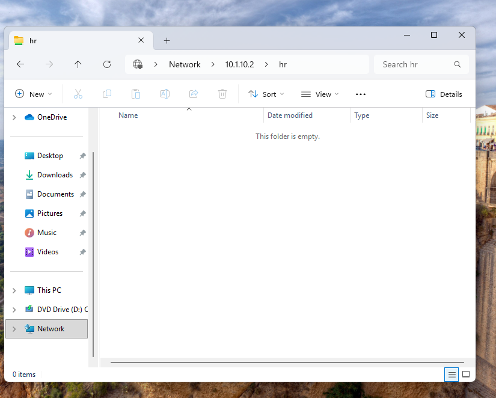

# Enterprise Active Directory & IT Support Operations Lab

## Executive Summary
Designed and deployed an enterprise virtual domain environment replicating corporate IT support and administration. The infrastructure features a Windows Server 2025 Domain Controller hosting the lab.local root domain, with two domain-joined Windows 11 endpoints: a dedicated Help Desk workstation equipped with Remote Server Administration Tools (RSAT) and a standard employee endpoint (Patty).

The lab demonstrates foundational system administration and Tier 1/2 support: implementing departmental Organizational Units (IT and HR), configuring Role-Based Access Control (RBAC), provisioning secured SMB network shares (HR and Personal), administering Active Directory remotely via RSAT, and resolving simulated help desk tickets using Spiceworks.

---

## Core Competencies & Environment

| Category | Technologies / Implementations |
| :--- | :--- |
| **Operating Systems** | Windows Server 2025, Windows 11 Pro/Enterprise |
| **Directory Services** | Active Directory Domain Services (AD DS), DNS, DHCP |
| **Remote Administration** | Remote Server Administration Tools (RSAT) — ADUC, GPMC, DNS Manager |
| **Network Storage** | SMB Network Shares (HR Department Share, Personal User Storage), NTFS & Share Permissions |
| **Service Management** | Spiceworks Help Desk (Ticket triaging, SLA tracking, resolution documentation) |
| **Identity & Security** | Role-Based Access Control (RBAC), Least-Privilege Administration, Domain Trust Management |

---

## Network & Architecture Map

```text
                                  [ lab.local Domain ]
                                           |
                 +-------------------------+-------------------------+
                 |                                                   |
       [ Domain Controller ]                               [ Internal Network ]
       Hostname: DC01                                      Subnet: 10.1.10.0/24
       OS: Windows Server 2025                             Gateway: 10.1.10.1
       IP: 10.1.10.2 (Static)                              DNS: 10.1.10.2
       Roles: AD DS, DNS, File Server                      Shares: \HR, \Personal
                 |                                                   |
                 +-------------------------+-------------------------+
                                           |
                      +--------------------+--------------------+
                      |                                         |
           [ Help Desk Workstation ]                 [ Standard User Client ]
           Hostname: HELPDESK-PC                     Hostname: PATTY-PC / Client02
           OS: Windows 11                            OS: Windows 11
           IP: 10.1.10.3 (Static/Assigned)           IP: 10.1.10.4 (DHCP)
           Role: IT Support / RSAT Console           User: Patty (HR Department)
```

---

## Implementation Details

### 1. Domain Architecture & Departmental Structure
- Installed and configured AD DS on Windows Server 2025, provisioning the lab.local forest root.
- Designed an enterprise Organizational Unit (OU) schema:
  - **IT OU:** Hosts administrative accounts, tier-specific support roles, and IT workstations.
  - **HR OU:** Contains standard staff accounts (including test user Patty) and departmental assets.
- Enforced centralized domain security policies: password complexity, account lockout thresholds after repeated invalid attempts, and mandatory first-login password updates.

### 2. Remote Server Administration (RSAT) & Least Privilege
- Configured a dedicated Windows 11 Help Desk PC with Remote Server Administration Tools (RSAT).
- Avoided direct Domain Controller interactive logins by managing user lifecycles, group memberships, and computer accounts remotely via RSAT from the Help Desk machine.
- Configured delegated administration in Active Directory Users and Computers (ADUC), giving the Help Desk account the exact rights needed to reset passwords and unlock accounts without full Domain Admin rights.
- Restricted the standard user account (Patty) to non-privileged local access to prevent unauthorized system modifications.

### 3. Network File Shares & Security Permissions
- **HR Share:** Restricted strictly to members of the HR-Department security group via NTFS access lists to prevent unauthorized cross-departmental data access.
- **Personal Share:** Provisioned as dedicated individual workspace storage for user document backups.
- Configured automated drive mapping via Group Policy Objects (GPOs) to mount these shares automatically upon user login.

---

## Incident Management & Simulated Tickets (Spiceworks)

### Ticket #101: Account Lockout
- **Requester:** Patty (HR Department)
- **Issue:** Account locked out after returning from leave; cannot log in to Windows 11.
- **Root Cause:** Multiple failed login attempts exceeded the domain account lockout threshold configured in the Default Domain Policy.
- **Troubleshooting & Resolution Steps:**
  1. Replicated and documented the account lockout error on the client workstation (`PATTY-PC`).
  2. Verified employee identity following corporate IT security protocol.
  3. Accessed Active Directory Users and Computers (ADUC) remotely via RSAT on `HELPDESK-PC`.
  4. Opened Patty's account properties, checked **Unlock account**, and enforced **User must change password at next logon**.
  5. Verified successful client sign-in on `PATTY-PC` and prompted user to establish a new secure domain password.


---

### Ticket #102: Network Share Permissions
- **Requester:** Patty (HR Department)
- **Issue:** "Access Denied" error dialog when attempting to open the departmental HR network folder.
- **Root Cause:** User account was omitted from the `HR` global security group, violating the NTFS Discretionary Access Control List (DACL).
- **Troubleshooting & Resolution Steps:**
  1. Replicated permission failure on `PATTY-PC` when attempting to access `\\10.1.10.2\hr`.
  2. Accessed ADUC via RSAT on `HELPDESK-PC` and audited Patty's group memberships.
  3. Added Patty's user object to the `HR` security group to grant authorized DACL inheritance.
  4. Had user sign out and sign back in to refresh Kerberos ticket-granting tokens (TGT).
  5. Verified full read and write access to the HR departmental share on the client endpoint.




---

### Ticket #103: Domain Trust Failure
- **Requester:** Patty (HR Department)
- **Issue:** Workstation boots with error: *"The trust relationship between this workstation and the primary domain failed."*
- **Root Cause:** Machine account secure channel password became desynchronized between the endpoint and the Domain Controller (`lab.local`).
- **Troubleshooting & Resolution Steps:**
  1. Documented domain authentication failure on the client Windows 11 logon screen.
  2. Bypassed the broken secure channel by logging into the local workstation administrator account (`.\Administrator` on `Client02`).
  3. Opened System Properties (`sysdm.cpl`) and accessed the Computer Name/Domain Changes configuration window.
  4. Disjoined the client to a temporary workgroup, reset the Active Directory computer object, and re-authenticated domain join credentials for `lab.local`.
  5. Confirmed the *"Welcome to the lab.local domain"* dialog, rebooted the endpoint, and verified successful domain user authentication for Patty.


---

### Ticket #104: DNS Misconfiguration & Name Resolution Failure
- **Requester:** Patty (HR Department)
- **Issue:** Client workstation unable to connect to network shares, resolve internal intranet resources, or locate domain services.
- **Root Cause:** Network interface had a static public DNS server (`8.8.8.8`) manually configured, preventing lookups for internal Active Directory SRV records and `lab.local` namespace zones.
- **Troubleshooting & Resolution Steps:**
  1. **Connectivity Layer Isolation:** Executed `ping 10.1.10.2` (succeeded with 0% loss) followed by `ping lab.local` (failed with "could not find host"), confirming Layer 3 network connectivity was intact and isolating the fault to DNS resolution (Layer 7).
  2. **Adapter Configuration Audit:** Executed `ipconfig /all` to audit interface properties; identified that the client's DNS server was pointed to external public resolver `8.8.8.8`.
  3. **Resolver Query Test:** Executed `nslookup lab.local`. Queries routed to `8.8.8.8` timed out because public recursive resolvers have no visibility into private domain zones.
  4. **Remediation & Cache Purge:** Reconfigured the adapter to point to the Domain Controller (`10.1.10.2`) using `netsh interface ip set dns name="Ethernet0" static 10.1.10.2`, then purged stale negative resolver entries using `ipconfig /flushdns`.
  5. **Resolution Verification:** Executed `nslookup lab.local` and `ping lab.local`. Confirmed internal DC DNS answered authoritatively and ICMP packets returned with 0% loss.


---

## Key Technical Takeaways
- **Remote Administration Hygiene:** Administered Active Directory remotely via RSAT on a Windows 11 client rather than direct console sessions on the production Domain Controller.
- **Data Protection via NTFS:** Applied defense-in-depth by combining SMB share permissions with granular NTFS security descriptors to safeguard departmental (HR) data.
- **Structured Troubleshooting:** Utilized systematic diagnostics (`ipconfig`, `ping`, `gpupdate`, `Test-ComputerSecureChannel`) paired with ticketing documentation to verify resolutions before closing requests.
